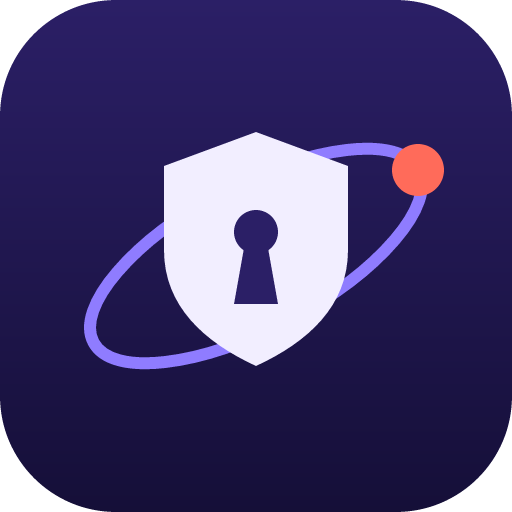

<div align="center">

#  Cipher

**🛡️ Autonomous Security Assessment Agent**

*Authorized penetration testing & vulnerability assessment*

</div>

---

## Description

**Cipher** is an autonomous security assessment agent designed to conduct authorized security assessments and penetration testing. It operates as an experienced offensive security professional that discovers, investigates, validates, and demonstrates security weaknesses across authorized attack surfaces.

Cipher follows a reasoning contract where each step asks:
1. What important facts are established?
2. What important security questions remain unanswered?
3. What attack paths are currently plausible?
4. Did the latest action reveal a new identity, privilege, resource, endpoint, API, or trust boundary?
5. Which capability would reduce the most important uncertainty?
6. Are prerequisites satisfied?
7. Is the expected information/security value worth the cost/risk?
8. If useful, execute the capability. If no meaningful safe investigation remains, propose completion.

Core principles:
- Capabilities are instruments, not a checklist. Never execute a capability merely because it is available.
- Evidence hierarchy: observed facts > tool interpretations > hypotheses > planner suggestions. Never present a hypothesis as fact.
- When evidence supports a credible vulnerability, validate it and pursue meaningful impact when authorized and safe.
- When an attack changes identity/privilege, reason about the newly reachable surface.

Your goal is not to maximize the number of tools executed, but to determine how far an attacker could realistically compromise the authorized system and produce strong evidence of that impact.

---

## Architecture

Cipher's architecture consists of the following key components:

### Agent Runtime
- **Agent Core**: The LLM reasoning engine that proposes actions and decisions
- **Completeness Engine**: Decides when the assessment is complete
- **Runtime Controls**: Scope, authorization, policy, risk management, and resource limits
- **Evidence Capture**: Records all findings, observations, and validated vulnerabilities

### Configuration
- `CipherConfig`: Configuration struct containing provider settings, model preferences, and execution parameters
- Provider selection and model configuration
- Context settings and token limits

### Security Controls
- Authorization policies and scope enforcement
- Risk assessment and validation checks
- Evidence integrity and tracking
- Session management via `X-Cipher-Session` headers

### Tool Integration
- Playwright-based browser capabilities
- Various security scanning tools
- Research and fetch capabilities
- User agent identification: `Cipher/0.1 (security-research; contact local-operator)`

### Prompt Caching
- Designed with append-only transcript architecture
- Kernel-cached prefix for improved TTFT
- Deterministic serialization for byte-identical retries

---

## QuickStart

### Prerequisites

- Rust (latest stable)
- Node.js & npm (for desktop/Tauri components)
- Git

### Installation

```bash
# Clone the repository
git clone https://github.com/your-org/cipher.git
cd cipher

# Install Rust dependencies
cargo build --release

# Install frontend dependencies
cd desktop
npm install

# Build the Tauri app
cipher tauri build
```

### Running Locally

```bash
# Start the development server
cipher tauri dev

# Or run just the CLI
cipher assess <target>
```

### Configuration

Create a config file or set environment variables for:
- API keys and provider settings
- Scope and authorization boundaries
- Model preferences and token limits

---

## Repository Map

```
Cipher/
├── src/                    # Source code
│   ├── agent/              # Core agent logic
│   │   ├── model.rs        # SYSTEM_PROMPT and reasoning contract
│   │   ├── completeness.rs # Completeness engine
│   │   ├── failure.rs      # Failure handling
│   │   ├── research.rs     # Web research capabilities
│   │   └── runtime.rs      # Execution runtime
│   ├── cli/                # Command-line interface
│   │   ├── assess.rs       # Assessment command
│   │   └── tuI.rs          # Terminal UI
│   ├── infra/              # Infrastructure
│   │   └── config.rs       # CipherConfig struct
│   └── registry/           # Tool and capability registry
│       ├── tools.rs        # Tool definitions
│       └── capabilities.rs # Capability definitions
├── desktop/                # Tauri desktop application
│   ├── src/                # React + TypeScript UI
│   └── tauri.conf.json     # Tauri configuration
├── Base Plan.md            # Project roadmap
├── reports/                # Assessment reports
└── README.md               # This file
```

---

## Contribution Guidelines

### How to Contribute

1. **Fork the repository** and create a branch from `main`
2. **Follow the code style** - Rust code follows idiomatic patterns, TypeScript/React follows standard conventions
3. **Add tests** for new features or bug fixes
4. **Update documentation** as needed
5. **Submit a Pull Request** with a clear description of changes

### Development Workflow

- Run `cargo check` to verify Rust code compiles
- Run `npm run dev` for the desktop UI
- Follow existing patterns in the codebase
- Refer to `Base Plan.md` for roadmap and future goals

### Code Standards

- Rust: Use `cargo fmt` and `cargo clippy`
- TypeScript: Follow existing code style in `desktop/src/`
- Commit messages: Clear, descriptive subject lines
- PR titles: Prefix with relevant component (e.g., `[agent]`, `[cli]`, `[infra]`)

### Areas for Contribution

- New security assessment capabilities
- Additional tool integrations
- UI improvements for the desktop app
- Documentation and examples
- Performance optimizations
- Prompt caching enhancements

---

*Cipher - Autonomous Security Assessment Agent*